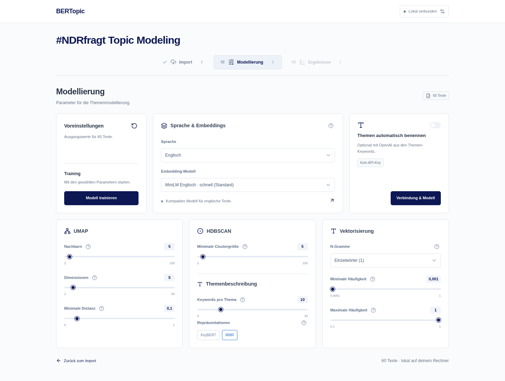

# Topic Modeling · #NDRfragt Themencluster

Lokale Themenanalyse mit **React/TypeScript**, **FastAPI** und **BERTopic**. Texte importieren, Modelle konfigurieren und Ergebnisse untersuchen – ohne Sidebar. Die aktuelle Anwendung liegt im Branch `dev`. Die weitere Entwicklung erfolgt direkt dort; neue Feature-Branches werden nur bei ausdrücklichem Bedarf angelegt.



## Schnellstart auf deinem Mac

Voraussetzungen: **Python 3.11 oder 3.12** und **Node.js 22 oder neuer**. Eine eigene Conda-Umgebung verhindert Konflikte mit `(base)`.

```bash
git fetch origin
git switch dev
git pull --ff-only
conda activate bertopic-dev
python -m pip install -r requirements.txt
python -m nltk.downloader stopwords
npm ci
npm run build
python -m server
```

Falls die Conda-Umgebung noch nicht existiert: `conda create -n bertopic-dev python=3.11 pip`, dann aktivieren. Falls der Branch nur remote existiert: `git switch --track origin/dev`.

Die App läuft auf deinem Rechner unter `http://127.0.0.1:8000`. Ein Python-Prozess liefert API und gebautes Frontend aus; Node ist im normalen Betrieb nicht nötig. `./scripts/start-web.sh` ist ein kurzer Alias für denselben Start. Nach Frontend-Änderungen erneut `npm run build` ausführen. Den Server nach Python-/Konfigurationsänderungen neu starten. Bestehende Modelle im RAM gehen dabei verloren.

**Linux ohne GPU:** Vor der Installation der Requirements bei Bedarf die CPU-Variante vorinstallieren:

```bash
python -m pip install 'torch==2.15.0' --index-url https://download.pytorch.org/whl/cpu
```

Auf Intel-macOS wählt `requirements.txt` automatisch PyTorch 2.2.2, NumPy 1.26 und dazu passende Versionen von Pandas, SciPy und Numba. Keinen Linux-CPU-Index auf dem Mac verwenden. Python 3.11 und 3.12 werden berücksichtigt; native Mac-Tests sind in der CI eingerichtet, die Cloud führt selbst Linux aus.

## Arbeitsablauf

### 1. Import

CSV (UTF-8) oder Excel hochladen, Trennzeichen prüfen und zuerst eine ID-Spalte wählen oder IDs generieren lassen. Danach die Textspalte(n) im durchsuchbaren Multiselect auswählen. Es gibt keine automatische Vorauswahl. Mehrere Textspalten werden für das Training untereinander angeordnet.

Die Originalvorschau zeigt zuerst die ID-Spalte und danach nur ausgewählte Textspalten. Bei „ID generieren“ bleibt die ID-Spalte dort zunächst leer. Nach „Daten bereinigen“ ersetzt die Vorschau die Originalwerte direkt durch die tatsächlich verwendeten bereinigten Texte einschließlich ihrer IDs.

Stichprobe und zusätzliche, durch Komma getrennte Stopwörter sind optional. Die Bereinigung entfernt URLs, Erwähnungen, Zahlen und Satzzeichen, wandelt in Kleinbuchstaben um und entfernt leere Texte. Dabei können fachlich wichtige Informationen verloren gehen; Vorschau prüfen.

### 2. Modellierung

Oben stehen drei Kacheln: **Voreinstellungen**, die breitere **Sprache & Embeddings**-Auswahl und **Themen automatisch benennen**. Darunter liegen UMAP, HDBSCAN/Themenbeschreibung und Vektorisierung. Kleine Info-Buttons erklären Parameter bei Bedarf.

Die Web-API behandelt `min_df` und `max_df` ausdrücklich als **Anteile zwischen 0 und 1**. Insbesondere wird JSON `max_df: 1` als `1.0` / 100 % interpretiert, nicht als absolute Häufigkeit 1. BERTopic wendet die Filter auf zusammengefasste Themen-Texte an. Ein zu hoher Mindestwert oder fehlendes Vokabular kann nach dem Clustering weiterhin eine sinnvolle Fehlermeldung auslösen.

Das lokale Training läuft als Hintergrundjob mit Fortschritt. Ungültige Parameter werden vor dem Laden des Sprachmodells geprüft. Ein fehlgeschlagenes Folgetraining verwirft vorherige Ergebnisse nicht. Änderungen an Formularwerten verändern kein bereits trainiertes Modell.

### 3. Ergebnisse

- Themen, Keywords und optional generierte Themennamen.
- Dauerhaft sichtbare Texttabelle unter beiden Ergebnisansichten: Suche, Themenfilter, Sortierung per Spaltenüberschrift und Pagination.
- Tatsächlich verwendete Trainingsparameter.
- Netzwerk/Dokumentenprojektion mit UMAP oder t-SNE als erste Visualisierung, Kosinus-Ähnlichkeitsmatrix und blaue Keyword-Balken mit Themen-Multiselect und einstellbarer Keyword-Anzahl.
- Outlier reduzieren und ursprüngliche Zuordnungen wiederherstellen. Ähnliche Themen nachträglich auf eine Zielanzahl zusammenfassen; dabei bleiben Outlier separat und die bisherige Outlier-Zurücksetzung entfällt.
- ZIP-Export mit Dokumenten-/Thementabellen als CSV und JSON sowie Parametern und Paketversionen.

Kosinus-Ähnlichkeit ist kein statistischer z-Wert. Keyword-Gewichte sind keine Wahrscheinlichkeiten. Eine zweidimensionale Dokumentenkarte ist explorativ zu interpretieren. Ein Seed garantiert keine hardwareübergreifend bitgleichen Ergebnisse.

## OpenAI: optionale Themennamen

Der Dialog über die Verbindungsschaltfläche oben rechts enthält Modell-Dropdown und **API-Zugriff prüfen**. Die Benennung ist standardmäßig aus und ohne Key deaktiviert. Sie lässt sich beim Training oder nachträglich mit Keyword-Vorschau auslösen. **ChatGPT Pro beinhaltet keine API-Nutzung**; API-Key und Abrechnung werden separat auf der [OpenAI Platform](https://platform.openai.com/api-keys) verwaltet.

Neue lokale Schlüssel in **`config/secrets.toml`** speichern:

```toml
OPENAI_API_KEY = "DEIN_VOLLSTÄNDIGER_OPENAI_API_KEY"
```

Alternativ den Schalter „Themen automatisch benennen“ aktivieren und den Key im Dialog eingeben. Dieser Key bleibt nur im Arbeitsspeicher des Python-Servers für den aktuellen Arbeitsbereich und hat dort Vorrang vor der Dateikonfiguration. Er wird nicht im Browser gespeichert und nach Serverneustart erneut benötigt. „Key übernehmen“ prüft noch keinen API-Zugriff; dafür „API-Zugriff prüfen“ verwenden.

`config/secrets.example.toml` ist eine Vorlage ohne Schlüssel. Die echte Datei ist von Git ausgeschlossen. Alternativ sind `BERTOPIC_OPENAI_API_KEY` oder `OPENAI_API_KEY` als Umgebungsvariable möglich. Projektdatei hat Vorrang vor globaler Konfiguration in `~/.config/bertopic-workbench/secrets.toml`, danach folgen Umgebungsvariablen. Der Browser erhält nur Anwesenheit und Quellenname, **niemals den Schlüssel**. Keine API-Keys in React oder `VITE_*`-Variablen eintragen.

**Umstieg von der alten App:** `python -m server` übernimmt eine vorhandene `.streamlit/secrets.toml` einmalig nach `config/secrets.toml` mit Dateirechten `0600`. Eine vorhandene neue Konfiguration wird niemals überschrieben; die alte Datei bleibt unverändert. Die Migrationshilfe benötigt kein Streamlit. Es gibt keine alte Streamlit-Anwendung oder entsprechende Laufzeitabhängigkeit mehr.

Die Benennung sendet nur Themen-IDs, bis zu zehn Keywords je Thema, Sprache und Benennungsanweisungen an OpenAI. Originaldateien, Dokumenttexte, Dokument-IDs und Embeddings bleiben lokal. **Keywords können trotzdem Namen oder vertrauliche Begriffe enthalten.** `store=false` ist gesetzt; es gelten weiterhin die [API-Datenregeln](https://platform.openai.com/docs/guides/your-data).

API-Kontrolle fragt nur Modell-Metadaten ab und generiert keine Antwort. Erfolg bestätigt nicht Guthaben oder Responses-Berechtigung. HTTP 401 bedeutet, dass der gefundene Wert abgelehnt wurde: echte aktive OpenAI-Platform-Keys statt Platzhaltern verwenden und angezeigte Quelle prüfen. API-Fehler erhalten das lokale Modell. Ein normaler UI-Rerender verursacht keine neue Benennung. Explizite erneute Benennung kann Kosten verursachen, auch wenn ein späteres Paket fehlschlägt. Nach Outlieränderungen werden alte KI-Namen verworfen.

## Entwicklung und Tests

`npm run dev` startet Python-API und Vite gemeinsam aus der aktivierten Python-Umgebung.

```bash
HF_HUB_OFFLINE=1 NUMBA_NUM_THREADS=2 OMP_NUM_THREADS=2 python -m unittest discover -s tests -v
npm run build
npx playwright install chromium
npm run test:e2e
```

Die Browser-Tests starten selbst `tests.fixtures.server` mit lokal erzeugten Test-Embeddings. Der reguläre Server verwendet echte Sprachmodelle. Tests prüfen Datenfluss, JSON-Zahlensemantik, Konfigurationsmigration, API-Fehler, Diagramme, Suche, Download, Reload sowie Desktop/Mobil. Sie benötigen weder vortrainierte Modell-Downloads noch API-Guthaben. Modellqualität und echte API-Zugriffe sind damit nicht belegt.

## Betrieb und Grenzen

Die App ist für lokalen Betrieb mit **einem Python-Worker** ausgelegt. Jobs laufen nacheinander. Sitzungen und Modelle liegen im RAM; ein Seiten-Reload findet sie wieder, ein Serverneustart nicht. Maximal 20 ruhende Arbeitsbereiche und 25 MB je Upload begrenzen den lokalen Datenumfang. Nach zwei Stunden ruhende Sitzungen werden bei der nächsten Neuanlage entfernt. Große Modelle benötigen dennoch viel RAM.

Abbrechen/Wiederaufnehmen laufender Jobs, dauerhaft gespeicherte Modelle, Login und verteilte Worker sind nicht implementiert. Für einen öffentlichen Mehrbenutzerdienst wäre ein gesondertes Betriebskonzept erforderlich. Deshalb ist der Standardstart auf `127.0.0.1` gebunden.

Details zur Modellauswahl: [Embedding-Modelle für Deutsch](docs/embedding-models.md). In eingeschränkten Netzen müssen Modell-Downloads von Hugging Face und optional `api.openai.com` erreichbar sein. MiniLM oder E5 small sind praktische Ausgangspunkte auf einem Intel-Mac; ein Leaderboard-Gesamtwert ersetzt keine Bewertung der eigenen Themen.

## Projektstruktur und Entwicklung

```text
src/
  App.tsx              # App-Einstieg (entspricht App.jsx mit TypeScript)
  App.css              # Gemeinsames Design
  pages/               # Import, Modellierung, Ergebnisse
  components/          # Wiederverwendbare Formulare, Dialoge, Fortschritt
  charts/              # Plotly-Anbindung
  context/             # Zustand und API-Arbeitsabläufe
  content/help.de.json # Zentral konfigurierbare Hilfetexte
server/
  app.py               # FastAPI und Auslieferung des Frontends
  routes/              # HTTP-Endpunkte
  services/            # Bereinigung, Training, Analyse, Visualisierung
public/                # Statische Dateien
tests/                 # Python- und Browsertests
```

React bleibt das Frontend; Python führt BERTopic aus. Ein Wechsel zu JavaScript würde diese Trennung nicht vereinfachen. Conda ist für die Python-Abhängigkeiten geeignet, Node/npm verwaltet das Frontend.

Nach Installation mit `npm ci` startet **`npm run dev`** API und Vite gemeinsam. Öffne die von Vite angezeigte Adresse (normalerweise `http://127.0.0.1:5173`). Änderungen am Frontend erscheinen direkt. Mit Ctrl+C beide Prozesse beenden; nach Python-Änderungen neu starten.

Für normalen lokalen Betrieb: `npm run build`, dann `npm start`. Ist Port 8000 belegt, den bisherigen Server mit Ctrl+C beenden oder `npm start -- --port 8001` verwenden. Für die Entwicklung alternativ `BACKEND_PORT=8001 npm run dev`. Der Start überschreibt keinen laufenden Server.

Prüfen: `python -m unittest discover -s tests -v`, `npm run build`, `npm run test:e2e`. Browsertests verwenden ein lokales Test-Embeddingmodell ohne externe API-Anfragen.

## Hilfetexte und Themennamen

Alle Texte der Hilfe-Buttons stehen in `src/content/help.de.json`. JSON wird direkt von Vite/TypeScript eingebunden, ohne zusätzliche YAML-Abhängigkeit. Zum Ändern die jeweilige Zeichenkette bearbeiten; in `npm run dev` aktualisiert sie sich direkt, für den normalen Betrieb danach `npm run build` ausführen. Änderungen an den Heuristiken in `server/services/modeling/configuration.py` müssen auch in der Voreinstellungs-Hilfe erklärt werden.

„Voreinstellungen“ verwendet feste, von Textanzahl und durchschnittlicher Länge abhängige Heuristiken und optimiert kein Modell automatisch. Zurücksetzen ändert nur die Formularwerte, nicht bestehende Ergebnisse.

Die Themenübersicht zeigt zuerst **Thema** (Nummer), dann **Themenname**. Die Texttabelle beginnt mit **ID → Thema → Themenname → Textbeitrag**, danach folgen weitere Felder. OpenAI-Namen erscheinen auch in Filtern, Diagrammen und Exporten. Ohne KI werden bis zu vier Keywords als lesbarer Name verwendet; Thema −1 heißt Outlier. Für OpenAI werden weiterhin maximal zehn Keywords pro Thema übertragen. Der Prompt wünscht präzise Titel mit normalerweise drei bis sechs Wörtern, bei Bedarf bis zu acht.

Unter „Ergebnisse verbessern“ lassen sich ähnliche Themen mit BERTopics agglomerativem Clustering der Themen-Embeddings auf eine gewünschte Anzahl reduzieren. Die Zahl schließt Outlier aus. Das trainierte Embedding-Modell wird dabei nicht neu trainiert. Die Operation arbeitet auf einer Kopie der veränderlichen Modellbestandteile; bei Fehlern bleiben bisherige Ergebnisse erhalten. Eine erfolgreich geänderte Themenstruktur verwirft alte Themennamen und die Outlier-Zurücksetzung für die vorherigen Themen-IDs. Die Reduktionshistorie wird im Export dokumentiert. „Themen neu benennen“ vergibt anschließend Namen für die aktualisierten Inhalte.

## Themen gezielt bearbeiten

Die Analyseansichten **Themenübersicht** und **Visualisierungen** stehen zentriert mit eigenen Icons direkt unter der Hauptnavigation. Die Texttabelle bleibt in beiden Ansichten verfügbar.

Unter **Ergebnisse verbessern** gibt es zusätzlich:

- **Themen gezielt zusammenführen:** Mindestens zwei Themen im Multiselect auswählen. Nur diese Themen werden zu einer Gruppe zusammengeführt. Andere Namen bleiben erhalten, auch wenn BERTopic die Themen-IDs neu nummeriert. Die neue Gruppe lässt sich danach direkt benennen; die bisherige Outlier-Zurücksetzung entfällt. Fehlgeschlagene Zusammenführungen verändern das Modell nicht.
- **Themennamen bearbeiten:** Thema auswählen, Namen mit bis zu 120 Zeichen eingeben und speichern. Dafür ist kein API-Key erforderlich. Der Name gilt in Tabellen, Filtern, Diagrammen und Exporten. Manuelle Namen haben Vorrang vor KI-Namen und bleiben bei erneuter KI-Benennung erhalten. Automatische Themenreduzierung und Outlier-Änderungen verwerfen hingegen Namen, da Inhalte und Zuordnungen sich ändern.

**Outlier (−1)** heißen immer „Outlier“. Sie sind von manueller und KI-Benennung sowie gezielter Zusammenführung ausgeschlossen. Hilfe-Buttons an der Outlier-Kennzahl und der Outlier-Bearbeitung erklären die Bedeutung. Manuelle Namen und Zusammenführungen werden im Export dokumentiert; wie die übrigen Ergebnisse liegen sie bis zum Serverneustart im Arbeitsspeicher.

Die blaue Schwalbe in `public/schwalbe.svg` steht vor dem App-Titel. Als Browser-Icon dient die weiße Variante `public/schwalbe-weiss.svg`. Blaue Aktionsbuttons verwenden einheitlich 200 × 48 Pixel (bei schmalen Containern höchstens deren Breite).

## Ergebnisse eingrenzen

„Ergebnisse verbessern“ ist in zwei Spalten mit drei Reihen angeordnet: Outlier-Zuordnung, automatische Reduktion, gezielte Zusammenführung, manuelle Namen, KI-Namen und Themenausschluss. Die Aktionsleisten eines Kartenpaars stehen auf gleicher Höhe; auf schmalen Bildschirmen werden die Karten untereinander angeordnet.

**Themen ausschließen** blendet ausgewählte Themen aus Tabellen, Kennzahlen, Visualisierungen und Export aus. Modell und Texte bleiben erhalten. „Alle wieder einblenden“ stellt die vollständige Auswertung wieder her. Der Export dokumentiert ausgeschlossene Themen und die ursprüngliche Dokumentanzahl. Mindestens ein Thema muss sichtbar bleiben. Vor Änderungen an der Themenstruktur müssen ausgeschlossene Themen wieder eingeblendet werden, damit IDs nicht unbemerkt ihre Bedeutung wechseln.

Das Netzwerk nutzt eigene Farben pro Themen-ID anstelle einer wiederholten Sechserpalette. Outlier sind grau; Umbenennen verändert die Farbe nicht. Bei sehr vielen Themen können Farben trotz unterschiedlicher Farbwerte ähnlich wirken; Legende und Hover nennen jeweils die konkrete Themen-ID.

Die Fortschrittsanzeige verwendet benannte Phasen und Prozentmarken statt einer zusätzlichen „6/6“-Zählung. Prozentwerte markieren Arbeitsschritte und stellen keine verbleibende Zeit dar.

## Tabellenbreiten und Netzwerk

Alle Tabellen haben ziehbare Trennlinien am rechten Rand der Spaltenüberschrift. Ziehen verändert die Breite, Doppelklick setzt die jeweilige Spalte zurück. Per Tab sind die Griffe erreichbar; die Pfeiltasten ändern die Breite, Home/End setzen die Grenzen. Breiten der Ergebnistabellen bleiben während der Sitzung beim Filtern und Blättern erhalten.

Im Netzwerk sind Outlier standardmäßig ausgeblendet. Ihre Legende bleibt sichtbar und kann zum Einblenden angeklickt werden. Das verändert weder Tabellen noch Kennzahlen oder Export. Das Icon für die Visualisierungen zeigt einen zentralen Knoten mit verbundenen Nachbarknoten.
