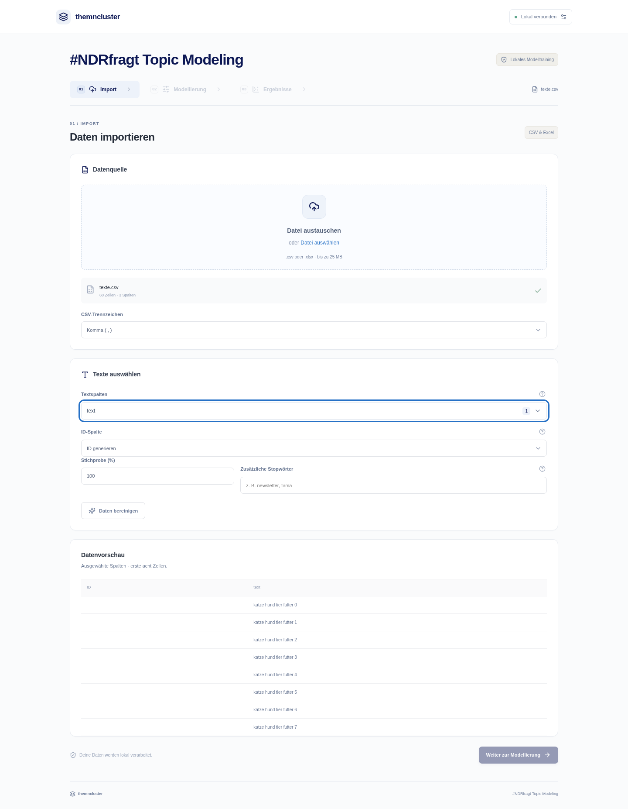
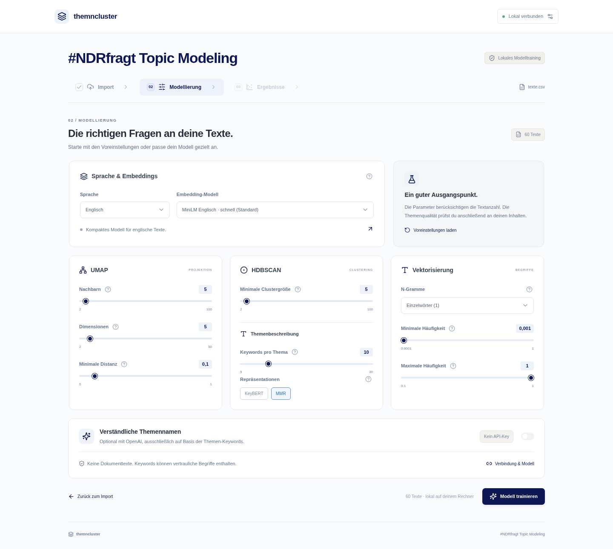

# React-Workbench

Die neue Oberfläche liegt im Branch `feature/react-workbench`. Die Streamlit-App ist weiterhin über `streamlit run app.py` nutzbar. Der neue Branch ersetzt weder `dev` noch `main`.

## Gestaltung und Datenvorschau

Die Oberfläche verwendet `#0C1754` als Hauptakzent, `#2671C6` für Hover/Fokus und einen fast weißen grauen Hintergrund (`#FAFBFC`). Die Marke lautet **themncluster**, der Titel **#NDRfragt Topic Modeling**. Die Datenquelle nutzt die volle Breite; darunter stehen Textspalten als Mehrfachauswahl im Dropdown sowie die übrigen Import-Einstellungen.

In der Originalvorschau steht zuerst die gewählte ID-Spalte, bei automatisch zu erzeugenden IDs zunächst eine leere ID-Spalte. Danach erscheinen ausschließlich ausgewählte Textspalten. Nicht gewählte Quellspalten bleiben ausgeblendet. Nach der Bereinigung lassen sich die tatsächlich verwendeten Texte einschließlich ihrer IDs separat aufklappen.



## Bewertung der Architektur

Streamlit war für den Prototyp passend. Für die gewünschte Oberfläche – klare Arbeitsschritte, kompakte Parameter im Hauptbereich, kontrollierter Zustand und gezieltes Laden von Diagrammen – lohnt sich eine separate Weboberfläche. Die eigentliche Themenmodellierung bleibt unverändert in Python.

React mit TypeScript wurde gewählt, weil Tabellen, Formulare, Plotly und Browser-Tests damit gut unterstützt werden. Svelte wäre ebenfalls geeignet und könnte weniger UI-Code erfordern; ein funktionaler Vorteil für BERTopic entsteht dadurch nicht. Die aufwendige Modellierung gehört bei beiden Varianten in ein Python-Backend.

**Keine Sidebar:** Import, Modellierung und Ergebnisse sind als horizontale Schrittnavigation zugänglich. Parameter sind direkt sichtbare Karten, Hilfetexte öffnen sich über kleine Info-Buttons. Modellierung und Ergebnisse bleiben bis zum nötigen vorherigen Schritt deaktiviert. Der OpenAI-Zugang ist als kompakter Dialog erreichbar; die optionale Benennung steht zusätzlich bei den Parametern und Ergebnissen.

Plotly bleibt für die wissenschaftlichen Ergebnisdiagramme erhalten. Es wird als eigener JavaScript-Chunk erst beim Öffnen der Visualisierungen geladen. Die Dokumentenprojektion wird einmal pro Training berechnet; Tabellen- oder Parameterklicks lösen sie nicht erneut aus. UMAP und t-SNE sind für die Dokumentenkarte auswählbar. Lucide liefert die UI-Icons. Alle Schriften kommen aus dem lokalen System, kein externer Font-Dienst ist nötig.



## Lokal starten, auch auf dem Mac

Voraussetzungen: Python 3.11/3.12 und Node.js 22 oder neuer. Die bisherigen Intel-Mac-Abhängigkeiten gelten weiterhin.

```bash
git fetch origin
git switch --track origin/feature/react-workbench
# Falls der Branch bereits lokal existiert: git switch feature/react-workbench
conda activate bertopic-dev
python -m pip install -r requirements-web.txt
python -m nltk.downloader stopwords

cd frontend
npm ci
npm run build
cd ..
./scripts/start-web.sh
```

Anschließend im Browser auf deinem Rechner `http://127.0.0.1:8000` öffnen. Der Python-Prozess liefert sowohl die API als auch das gebaute Frontend aus; im normalen Betrieb ist kein zweiter Node-Server nötig. Vor dem nächsten Start nach Frontend-Änderungen erneut `npm run build` ausführen.

### Entwicklung mit Live-Reload

Terminal 1, im Repository und aktivierten Python-Environment:

```bash
python -m uvicorn web_api.app:app --host 127.0.0.1 --port 8000
```

Terminal 2:

```bash
cd frontend
npm ci
npm run dev
```

Die Entwicklungsoberfläche läuft auf Port 5173 und leitet `/api` an Port 8000 weiter. Python-Änderungen erfordern einen Serverneustart; aktive Trainings werden dabei beendet und der Arbeitsspeicherzustand geht verloren. Die Anwendung verwendet **einen** Python-Worker, da Sitzungen und Jobs im Prozessspeicher liegen.

## Funktionsumfang

- CSV/Excel, automatische Trennzeichenerkennung und manuelle CSV-Auswahl, Vorschau.
- Eine oder mehrere Textspalten, generierte/existierende IDs, Stichprobe, zusätzliche Stopwörter, Bereinigung und Kennzahlen.
- Sprach- und Embedding-Auswahl mit denselben Modellen wie Streamlit.
- Alle UMAP-, HDBSCAN-, N-Gramm-, Häufigkeits- und Repräsentationsparameter; Prüfung vor dem Training.
- Training als Hintergrundjob mit Status und Fortschritt. Vorhandene Ergebnisse bleiben bei einem fehlgeschlagenen neuen Training erhalten.
- Themenübersicht, durchsuchbare und paginierte Dokumente, Gruppierung nach ID sowie tatsächliche Trainingsparameter.
- Ähnlichkeitsmatrix, auswählbare Keyword-Balken (bis zu vier Themen), UMAP-/t-SNE-Dokumentenkarte.
- Ausreißerreduktion und echtes Zurücksetzen der ursprünglichen Zuordnungen.
- Optionale OpenAI-Benennung mit Keyword-Vorschau, Modelldropdown und Zugriffskontrolle; API-Fehler erhalten das lokal trainierte Modell.
- ZIP-Export einschließlich CSV/JSON, Namen, Parametern und Metadaten.
- Responsive Darstellung auf Desktop und Mobilgeräten, beschriftete Controls und bedarfsweise Hilfetexte.

Die Parameter ändern nie rückwirkend ein trainiertes Modell. Die Ergebnisansicht und der Export verwenden die Konfiguration des dazugehörigen Trainings.

## OpenAI und Datenfluss

Der Python-Server liest `.streamlit/secrets.toml` im Repository (vor globalen Secrets) bzw. `BERTOPIC_OPENAI_API_KEY` / `OPENAI_API_KEY` aus der Umgebung. Das Frontend erhält nur Key-Anwesenheit und Quellenname, niemals den Schlüssel. Kein Key muss in React oder in eine `VITE_*`-Variable eingetragen werden. Nach Änderungen an Secrets den Python-Server neu starten.

CSV-/Excel-Daten gehen an den lokalen Python-Server. Embeddings und Clustering laufen lokal. Nur bei ausdrücklicher Aktivierung bzw. einem Klick auf die Benennung gehen Themen-IDs und Keywords an OpenAI – keine Dokumenttexte, Dokument-IDs oder Embeddings. Keywords können vertrauliche Begriffe enthalten. ChatGPT Pro enthält keine API-Nutzung. Details zur API-Verwendung stehen im entsprechenden Abschnitt der Haupt-README.

## Aufbau

```text
frontend/                  React, TypeScript, Vite, Styles und Browser-Tests
web_api/app.py             FastAPI-Endpunkte, lokale Sitzungen und Hintergrundjobs
modules/modeling/          Gemeinsam verwendete Konfiguration und Trainingslogik
modules/analysis/          Gemeinsam verwendete Analyse, Export und KI-Benennung
modules/viz/bar_chart.py   Plotly-Balken ohne Streamlit-Abhängigkeit
modules/viz/projection.py  Projektion ohne Streamlit-Abhängigkeit
scripts/start-web.sh       Lokaler Start mit gebautem Frontend
tests_web/                 API-Integration und expliziter Offline-Testserver
```

## Grenzen dieses lokalen Betriebs

Die neue Oberfläche ist ein funktionsfähiger lokaler Arbeitsbereich, kein fertig betriebener öffentlicher Mehrbenutzerdienst. Sitzungen und Modelle liegen im RAM; Browser-Reload kann sie über eine lokale Workspace-ID wiederfinden, ein Serverneustart nicht. Ruhende Arbeitsbereiche werden nach zwei Stunden bei der nächsten Neuanlage entfernt. Maximal 20 lokale Arbeitsbereiche und 25 MB je Upload begrenzen den Speicherbedarf. Schwere Modelle benötigen trotzdem viel RAM.

Trainings und Änderungen an Ergebnissen laufen nacheinander in einer lokalen Job-Queue. Ein laufender Job lässt sich in dieser Version nicht abbrechen. Dauerhafte Modelle, zuverlässige Wiederaufnahme, Login und verteilte Worker wären eigenständige nächste Schritte für einen öffentlichen Betrieb. Den Server deshalb wie dokumentiert nur an `127.0.0.1` binden.

Modell-Downloads und die API benötigen weiterhin Netzfreigaben. Die Tests belegen Funktion und Datenfluss mit lokalen Test-Embeddings und simulierten API-Antworten, nicht die semantische Qualität oder Verfügbarkeit fremder Modellgewichte.

## Prüfen

```bash
python -m unittest discover -s tests -v
python -m unittest discover -s tests_web -v
cd frontend
npm ci
npm run build
npx playwright install chromium
npm run test:e2e
```

Browser-Tests starten einen expliziten Offline-Testserver aus `tests_web/serve_e2e.py`. Nur dieser Testserver ersetzt den Encoder durch deterministische Test-Vektoren. Die normale Startdatei `web_api.app:app` verwendet immer die wirklichen Embedding-Modelle. Browser-Tests prüfen Desktop/Mobil, Import, Training, alle Diagramme, Suche, Download und Wiederherstellung nach Seiten-Reload. Screenshots werden unter `frontend/test-results/` erzeugt; das Verzeichnis ist nicht eingecheckt.

Wenn das Python-Environment nicht über `python` erreichbar ist, `BERTOPIC_PYTHON=/pfad/zur/python` vor `npm run test:e2e` setzen. Ein vorhandenes Chromium lässt sich über `CHROMIUM_PATH` auswählen. Die Tests verwenden kein API-Guthaben und laden keine vortrainierten Sprachmodelle herunter.
